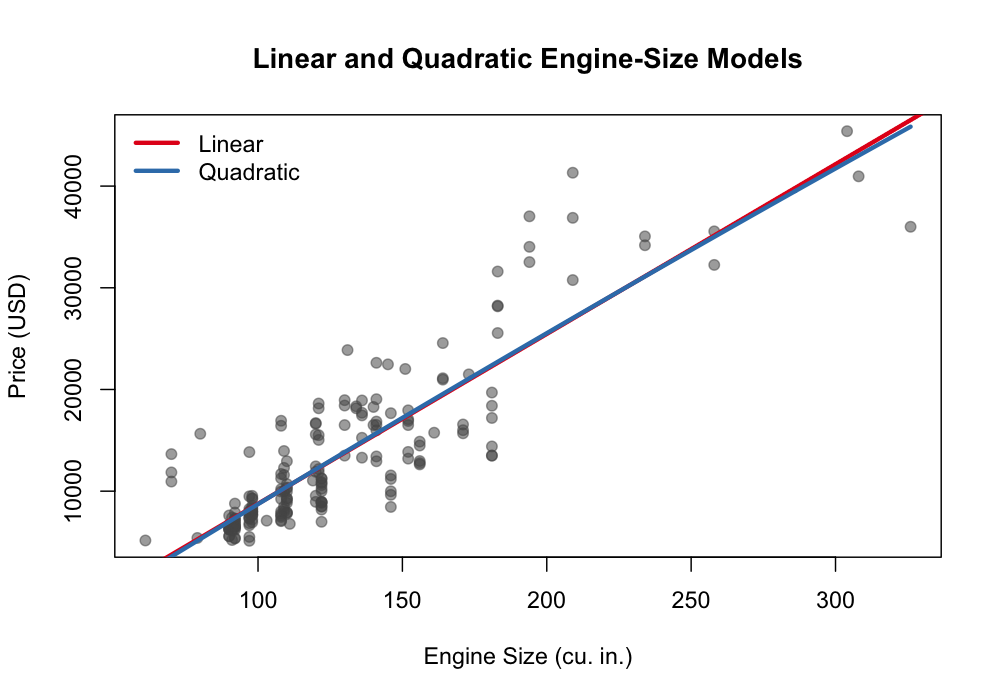

<<<<<<< HEAD

# Automobile Price Prediction in R

An exploratory regression project examining how vehicle specifications relate
to automobile prices. The analysis uses the UCI Automobile dataset and compares
simple, polynomial, and multiple linear regression models.

## Questions explored

- Which individual specification is most strongly associated with price?
- Does a curved relationship improve the engine-size model?
- Does combining engine size and horsepower improve predictions?
- How well do the candidate models perform on unseen observations?

## Visualizations

### Relationships between vehicle specifications and price

The plots below show how vehicle width, curb weight, engine size, and horsepower relate to price.


### Linear vs. quadratic engine-size models

This comparison examines whether a curved relationship represents the connection between engine size and price better than a straight line.



## Methods

- Data cleaning and missing-value handling
- Exploratory data visualization
- Simple and multiple linear regression
- Quadratic regression
- Model comparison using AIC and training R-squared
- 80/20 holdout evaluation using RMSE, MAE, and test R-squared
- Residual diagnostic plots

## Repository structure

```text
automobile-price-analysis/
├── analysis.R              # Complete reproducible analysis
├── data/
│   └── README.md           # Dataset information
├── outputs/                # Generated tables and figures
├── .gitignore
├── LICENSE
└── README.md
```

## How to run

1. Install [R](https://cran.r-project.org/).
2. Download or clone this repository.
3. Open a terminal in the repository's root directory.
4. Run:

```bash
Rscript analysis.R
```

The script automatically downloads the dataset on its first run. It then saves
model-comparison tables, figures, diagnostics, and a text summary in `outputs/`.
The analysis uses only base R, so no additional packages are required.

## Model evaluation

The project uses a fixed random seed and holds out 20% of complete observations
for testing. Candidate models are ranked by test RMSE. This is a small
educational dataset, so the results should be interpreted as an introduction to
regression—not as a production vehicle-pricing system.

After running the analysis, see:

- `outputs/model_evaluation.csv` for holdout metrics
- `outputs/single_model_comparison.csv` for individual-predictor results
- `outputs/engine_size_models.png` for the linear/quadratic comparison
- `outputs/best_model_diagnostics.png` for residual diagnostics

## Data source

The project uses the [UCI Automobile dataset](https://archive.ics.uci.edu/dataset/10/automobile),
originally donated by Jeffrey C. Schlimmer. Missing values represented by `?`
are converted to `NA`, and rows missing variables required by the analysis are
excluded.

## Limitations

- The dataset is small and dates from 1985.
- The holdout result can vary across different train/test splits, although the
  fixed seed makes this analysis reproducible.
- Linear regression assumptions and influential observations require careful
  review before using the model beyond this educational analysis.

## Author

# Josh Guzman

# automobile-price-analysis

Automobile price prediction in R using exploratory data analysis, regression modeling, and holdout model evaluation.

> > > > > > > 0510087d17e965f040b25839687373b65af5644b
