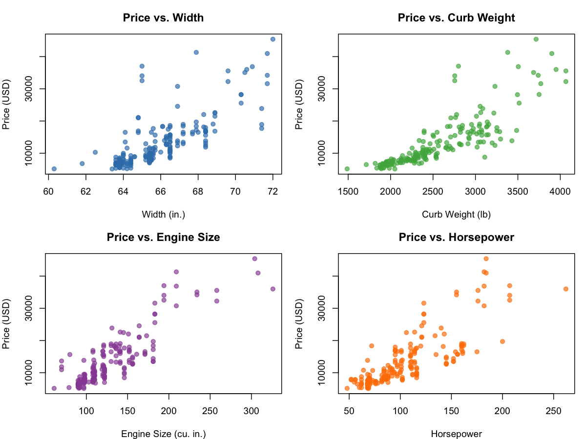
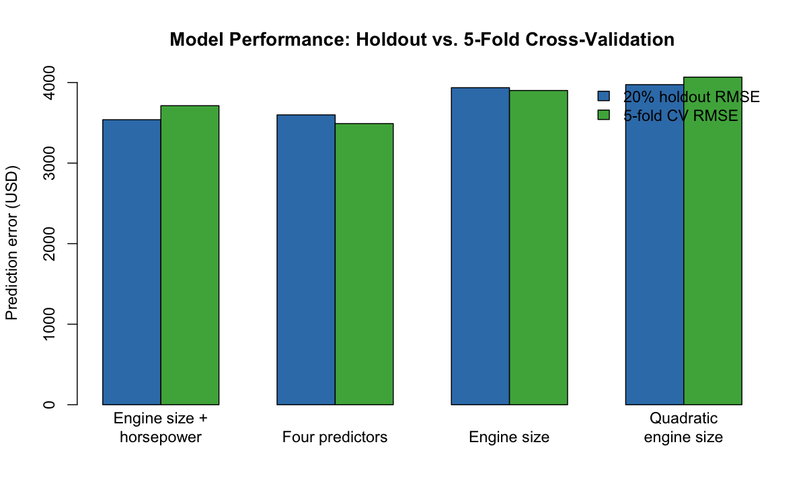

# Automobile Price Prediction in R

Reproducible regression analysis of the UCI Automobile dataset, using vehicle specifications to explain and predict automobile prices.

The project compares single-predictor, polynomial, and multiple linear regression models, then evaluates their performance on unseen observations. It demonstrates a complete introductory data-analysis workflow in base R: data cleaning, exploratory visualization, model development, evaluation, and diagnostics.

## Key findings

- The analysis uses 199 complete observations from the original 205-row dataset.
- Engine size was the strongest individual predictor among the specifications tested.
- The engine-size-plus-horsepower model performed best on the fixed 20% holdout set, achieving a test R² of approximately **0.869**.
- Five-fold cross-validation favored the four-predictor model, showing why model rankings should not rely on one train/test split.
- Multiple vehicle specifications produced more useful predictions than engine size alone.

## Questions explored

- Which individual vehicle specification is most strongly associated with price?
- Does a quadratic relationship improve the engine-size model?
- Does combining engine size and horsepower improve predictions?
- How well do the candidate models perform on unseen observations?

## Visualizations

### Vehicle specifications and price

These plots show the relationships between vehicle price and width, curb weight, engine size, and horsepower.



### Linear versus quadratic engine-size models

This comparison tests whether a curved relationship describes the connection between engine size and price better than a straight line.


### Model diagnostics

Residual diagnostic plots for the best-performing holdout model are available in [`outputs/best_model_diagnostics.png`](outputs/best_model_diagnostics.png).

### Model performance

This chart compares holdout and cross-validation error across the candidate models.



## Methods

- Missing-value handling and complete-case filtering
- Exploratory data visualization
- Simple linear regression
- Quadratic regression
- Multiple linear regression
- Model comparison using AIC and R²
- Fixed 80/20 holdout evaluation
- Five-fold cross-validation
- Test RMSE, MAE, and R²
- Residual diagnostics

The analysis uses only base R; no additional packages are required.

## Repository structure

```text
automobile-price-analysis/
├── analysis.R                         # Complete reproducible analysis
├── data/
│   ├── imports-85.data                # UCI Automobile dataset
│   └── README.md                      # Dataset documentation
├── outputs/
│   ├── analysis_summary.txt            # Model summary and evaluation results
│   ├── best_model_diagnostics.png     # Residual diagnostic plots
│   ├── engine_size_models.png         # Linear/quadratic comparison
│   ├── key_predictors.png             # Exploratory visualizations
│   ├── model_performance.png          # Holdout vs. cross-validation error
│   ├── business_summary.txt            # Practical interpretation and next steps
│   ├── cross_validation.csv            # Five-fold cross-validation metrics
│   ├── model_evaluation.csv           # Holdout model metrics
│   └── single_model_comparison.csv    # Individual-predictor comparison
├── .gitignore
├── LICENSE
└── README.md
```

## How to run

1. Install [R](https://cran.r-project.org/).
2. Clone or download this repository.
3. Open a terminal in the repository root.
4. Run:

```bash
Rscript analysis.R
```

The script reads the included dataset, creates the `outputs/` directory if needed, and regenerates the tables, figures, diagnostics, and summary report.

## Results and business interpretation

The fixed 20% holdout results are:

| Model | Test RMSE | Test MAE | Test R² |
|---|---:|---:|---:|
| Engine size + horsepower | $3,538 | $2,422 | 0.869 |
| Engine size + horsepower + curb weight + width | $3,598 | $2,249 | 0.865 |
| Engine size | $3,936 | $2,816 | 0.838 |
| Quadratic engine size | $3,974 | $2,858 | 0.835 |

Five-fold cross-validation provides a more stable comparison across multiple splits. It favors the four-predictor model, with an average RMSE of approximately **$3,490**, compared with approximately **$3,713** for the engine-size-plus-horsepower model.

From a business perspective, engine size and horsepower are useful early signals for estimating vehicle price, but a practical pricing system should also incorporate vehicle make, body style, fuel economy, age, mileage, condition, and current market conditions. The model should be recalibrated against current listings before being used for operational decisions.

See [`outputs/business_summary.txt`](outputs/business_summary.txt) for a concise stakeholder-facing interpretation. The complete evaluation tables are available in [`outputs/model_evaluation.csv`](outputs/model_evaluation.csv), [`outputs/cross_validation.csv`](outputs/cross_validation.csv), and [`outputs/single_model_comparison.csv`](outputs/single_model_comparison.csv).

## Skills demonstrated

- Data cleaning and reproducible analysis in R
- Exploratory data analysis and visual storytelling
- Statistical modeling and feature comparison
- Holdout testing and cross-validation
- Error analysis using RMSE, MAE, and R²
- Translating model results into business recommendations

## Data source

The project uses the [UCI Automobile dataset](https://archive.ics.uci.edu/dataset/10/automobile), originally donated by Jeffrey C. Schlimmer. Missing values represented by `?` are converted to `NA`, and rows missing variables required by the analysis are excluded.

## Limitations

- The dataset is small and dates from 1985.
- Results depend on the selected holdout split, although the fixed seed makes this run reproducible.
- The model is intended for educational and portfolio use, not production vehicle pricing.
- Linear-model assumptions and influential observations should be reviewed before making operational decisions.

## Author

Josh Guzman
